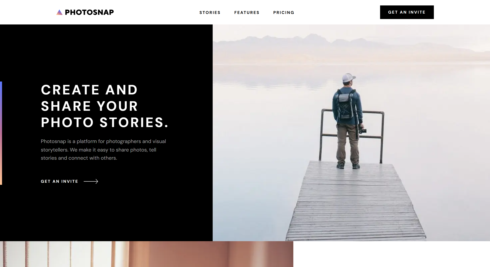

# Photosnap Web Application
A fully responsive multi-page marketing and platform web application designed for photographers and visual storytellers. This project was built as a modern, high-performance web experience featuring clean aesthetics, smooth UI transitions, and modular component architecture.

## ✨ Features
- **Multi-Page Layout**: Fully realized pages for Home, Stories, Features, and Pricing.

- **Responsive Design**: Optimized layout ensuring stunning visual presentation across mobile, tablet, and desktop screens.

- **Interactive Story Galleries**: Dynamic showcase grids highlighting visual stories complete with author attribution and navigation prompts.

- **Rich Media & Embed Support**: Designed to handle responsive image galleries and embedded media layouts.

- **Modern UI & Micro-Interactions**: Smooth hover states, custom typography, and clean dark/light UI balancing.

## 🛠️ Built With
- **Framework**: Next.js / React

- **Styling**: Tailwind CSS

- **Animations**: Framer Motion

- **Language**: TypeScript / JavaScript